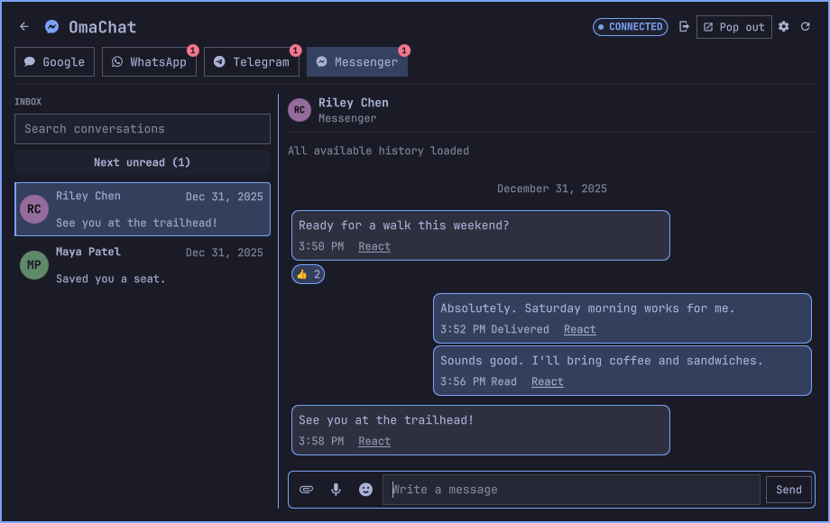

# Theme gallery

These are captures of the real OmaChat QML panel with fictional contacts and
messages, rendered using the stock Omarchy theme base palettes listed below.
The fixture uses default control styling, not machine-specific shell overrides.
The connected state and delivery receipts are simulated demonstration data.
They are not proof of live connectivity or a full desktop theme installation.
The refreshed provider captures show all four service tabs, per-service unread
badges, Messenger, reactions, and the shared attachment, voice, and emoji controls.
The additional captures show the optional unified inbox and offline emoji search.

## Tokyo Night

## Catppuccin Latte

## Gruvbox

## Optional unified inbox

Google Messages is disabled in this fictional setup. The All tab reports
Connected from the enabled services, and rows retain their provider badges.

## Offline emoji search

Generated with `python3 tests/render-gallery.py` on an Omarchy Wayland desktop.
The renderer never starts the protocol helper or accesses accounts. It reads
the installed stock `colors.toml` files and changes colors only inside its
temporary process, with separate temporary configuration, data, cache, and
runtime directories. No real contacts, messages, profile images, or wallpaper
assets are used. The root preview is refreshed automatically from the Tokyo
Night capture. The renderer also checks native header status changes with
Google disabled, a partially connected set, and an offline helper.
